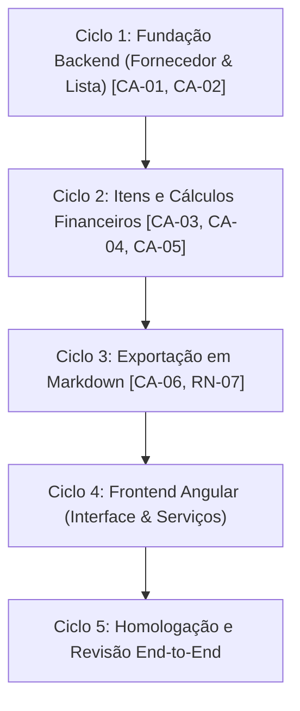

# Plano de Implementação da Feature 001: Lançamento de Pedidos de Compras

**Referência Canônica da Spec:** `docs/specs/001-lancamento-pedidos-compras.md`  
**Arquitetura:** Backend Spring Boot (`msaas/back/pedidos_conectado`) + Frontend Angular (`msaas/front/pedidos_conectado`)  
**Estratégia de Desenvolvimento:** Construção gradual em ciclos determinísticos com validação estática rigorosa e testes automatizados.

---

## 1. Visão Geral e Critérios de Ordenação

A ordem de execução foi estabelecida a partir da cadeia de dependências de domínio e valor de negócio:
1. **Fundação e Vínculo de Entidades-Mãe:** Uma lista de compras depende compulsoriamente da existência de um fornecedor (`RN-01`). Portanto, o cadastro de fornecedor e a criação/renomeação de lista são os pré-requisitos absolutos.
2. **Itens e Motor de Cálculo Financeiro:** Os cálculos de subtotais (`RN-04`), desconto monetário (`RN-05`) e piso zero (`RN-06`) dependem dos itens associados à lista (`RN-02`).
3. **Exportação Canônica em Markdown:** A exportação (`RN-07`) consome todos os dados consolidados da lista, fornecedor e itens.
4. **Interface do Usuário (Frontend Angular):** Consome os contratos de API REST já estabilizados e testados no backend.
5. **Homologação e Revisão Final:** Validação integrada ponta a ponta dos critérios `CA-01` a `CA-06`.

---

## 2. Divisão dos Ciclos de Desenvolvimento

---

### Ciclo 1: Fundação Backend - Fornecedor e Gestão de Listas de Pedidos
- **Status:** CONCLUÍDO NESTA ITERAÇÃO
- **Critérios de Aceite Atendidos:**
  - `CA-01`: Cadastro de Fornecedor e Criação da Lista vinculada com status financeiro zerado inicial.
  - `CA-02`: Renomeação Dinâmica da Lista a qualquer instante sem impacto nos vínculos.
- **Regras de Negócio Implementadas:**
  - `RN-01`: Vínculo Mandatório de Empresa Fornecedora existente.
  - `RN-03`: Renomeação Irrestrita de Título (3 a 100 caracteres).
- **Entregas Técnicas:**
  - Entidade de Domínio `Fornecedor` (`id`, `razaoSocial`, `nomeFantasia`, `cnpj`, `contato`) com validações de tamanho e normalização de texto.
  - Entidade de Domínio `ListaPedido` (`id`, `empresaId`, `titulo`, `dataCriacao`, `descontoReais`).
  - Repositórios Spring Data JPA: `FornecedorRepository`, `ListaPedidoRepository`.
  - Serviços de Aplicação: `FornecedorService`, `ListaPedidoService`.
  - DTOs de Entrada e Saída com campos monetários e status financeiro inicial determinístico.
  - Controladores REST: `FornecedorController` (`/api/fornecedores`) e `ListaPedidoController` (`/api/listas`).
  - Tratamento Global de Exceções (`GlobalExceptionHandler`) com respostas padronizadas HTTP 400/404.
  - Suporte a CORS para integração com o frontend Angular.
  - Testes Automatizados cobrindo `CA-01`, `CA-02`, e cenários de erro (fornecedor inexistente, títulos inválidos, razão social inválida).

---

### Ciclo 2: Gestão de Itens, Isolamento e Motor de Cálculo Financeiro
- **Status:** CONCLUÍDO NESTA ITERAÇÃO
- **Critérios de Aceite Atendidos:**
  - `CA-03`: Inserção de Item e Isolamento Estrito por Lista.
  - `CA-04`: Cálculo Correto do Subtotal dos Itens e da Lista.
  - `CA-05`: Aplicação de Desconto Fixo com função $\max(0, \text{Subtotal} - \text{Desconto})$.
- **Regras de Negócio Implementadas:**
  - `RN-02`: Isolamento Estrito de Itens (sem catálogo mestre global).
  - `RN-04`: Cálculo de Subtotais ($\text{Qtd} \times \text{Preço Unitário}$) e somatório geral.
  - `RN-05`: Desconto Fixo em Reais ($\ge 0$, valor negativo rejeitado).
  - `RN-06`: Total Líquido Não-Negativo com Piso Zero.
  - Tabela da Seção 8: Cenários 1 a 9 da especificação.
- **Entregas Técnicas:**
  - Entidade `ItemPedido` vinculada à `ListaPedido` com validações de domínio (descrição, quantidade $> 0$, preço unitário $\ge 0$).
  - Repositório `ItemPedidoRepository` com busca e deleção por `listaId`.
  - Métodos em `ListaPedidoService` para adição, listagem e remoção de itens com isolamento estrito, além de aplicação de desconto monetário fixo e cálculo dinâmico de total líquido com piso zero.
  - Endpoints REST em `ListaPedidoController` para gestão de itens e desconto.
  - Suíte completa de testes unitários e de camada web cobrindo `CA-03`, `CA-04`, `CA-05` e todos os 9 cenários da Seção 8.

---

### Ciclo 3: Exportação Canônica em Markdown
- **Status:** CONCLUÍDO NESTA ITERAÇÃO
- **Critérios de Aceite Atendidos:**
  - `CA-06`: Exportação Completa Formatada em Markdown.
- **Regras de Negócio Implementadas:**
  - `RN-07`: Estrutura canônica de cabeçalho (título e data de criação), informações da empresa fornecedora (razão social, CNPJ e contato), tabela com colunas (`Item`, `Descrição`, `Qtd`, `Preço Unitário (R$)`, `Subtotal (R$)`) e resumo financeiro discriminado (`Subtotal dos Itens`, `Desconto Aplicado (R$)`, `Total Final Líquido (R$)`).
- **Entregas Técnicas:**
  - Serviço `ExportacaoMarkdownService` com formatação monetária em padrão brasileiro (`R$ X,XX`) e determinação de linhas da tabela.
  - Método `exportarMarkdown()` em `ListaPedidoService`.
  - Endpoint REST `GET /api/listas/{id}/exportar-markdown` com Content-Type `text/markdown; charset=UTF-8`.
  - Testes automatizados unitários e de controlador validando o critério `CA-06`, `RN-07`, listas vazias e listas com múltiplos itens.

---

### Ciclo 4: Frontend Angular - Telas e Integração
- **Status:** PENDENTE (Próxima iteração)
- **Escopo:**
  - Serviços Angular em `pedidos-conectado` (`FornecedorService`, `ListaPedidoService`).
  - Componentes Standalone:
    - Tela de Cadastro e Seleção de Fornecedores.
    - Tela de Gestão de Listas de Pedidos (criação e renomeação em tempo real).
    - Painel de Itens do Pedido (lançamento, listagem e exclusão).
    - Resumo Financeiro reativo (subtotal, campo de desconto em R$ e total líquido com piso zero).
    - Modal / Área de visualização e cópia do relatório Markdown.
  - Testes unitários com Vitest / Angular Testing Utilities.

---

### Ciclo 5: Homologação Integrada e Revisão Final
- **Status:** PENDENTE
- **Escopo:**
  - Testes end-to-end de fluxo completo.
  - Validação de conformidade contra todos os itens do anti-escopo da Seção 2.2.
  - Relatório final de cobertura e auditoria estática.
